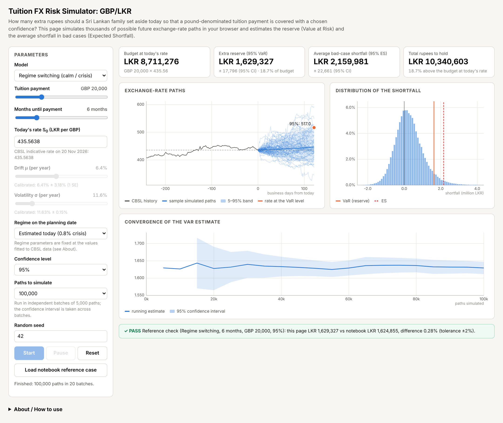
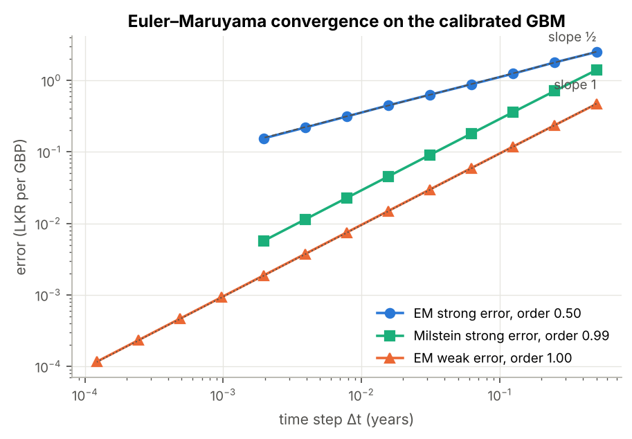

# Tuition FX Risk Simulator: GBP/LKR

**How many extra rupees should a Sri Lankan family set aside today to be 95% sure of covering a UK tuition payment in pounds?** This project answers that with Monte Carlo simulation of the GBP/LKR exchange rate, calibrated to Central Bank of Sri Lanka data.

**▶ Live demo:** <https://dinethminmu.github.io/fx-tuition-risk/> &nbsp;·&nbsp;
[](https://colab.research.google.com/github/DinethminMU/fx-tuition-risk/blob/main/notebook/fx-tuition-risk.ipynb)



## The problem

Many Sri Lankan families save for UK university fees in rupees but pay in pounds months later. If the rupee weakens in between, their savings fall short. In March–April 2022, after the rupee was allowed to float, GBP/LKR rose from 265 to 437 in about six weeks.

**Question:** how many additional rupees must a family set aside today to be 95% confident of covering a **GBP 20,000** payment due in **3, 6 or 12 months**?

## Quick start

**Notebook (recommended):** click **Open in Colab** above, then **Runtime → Run all**. The first cell downloads this repository and installs the packages. The full run takes about 5 minutes on a free Colab runtime, and all random seeds are fixed.

**Locally:**

```bash
git clone https://github.com/DinethminMU/fx-tuition-risk.git
cd fx-tuition-risk
pip install -r requirements.txt
pytest -q                                   # 31 verification tests
jupyter notebook notebook/fx-tuition-risk.ipynb
```

**Web demo:** open the [live demo](https://dinethminmu.github.io/fx-tuition-risk/), or double-click `docs/index.html`. It runs entirely in the browser, with no installation.

## Using the demo

Choose a model (GBM or calm/crisis regime switching), the tuition amount, the months until payment and the confidence level, then press **Start**. The page simulates paths in batches and updates the reserve (Value at Risk), the average bad-case shortfall (Expected Shortfall) and three live charts. **Load notebook reference case** reproduces the notebook's result and shows a pass/fail check. Full guide with screenshots: **[USER_GUIDE.md](USER_GUIDE.md)**.

## Model and maths

The exchange rate $S_t$ (LKR per GBP) follows geometric Brownian motion,

$$dS_t=\mu S_t\,dt+\sigma S_t\,dW_t,\qquad S_T=S_0\exp\Big(\big(\mu-\tfrac{1}{2}\sigma^2\big)T+\sigma\sqrt{T}\,Z\Big),$$

with $\mu$ and $\sigma$ estimated by maximum likelihood from daily log-returns. The family's shortfall is $L=A\,(S_T-S_0)$ with $A=20{,}000$ GBP. The reserve is $\mathrm{VaR}_{0.95}(L)$, and $\mathrm{ES}_{0.95}(L)=E[L\mid L\ge \mathrm{VaR}_{0.95}]$ measures how bad the worst 5% of outcomes are. Both are estimated from 30 independent replications of 100,000 paths, with Student-t confidence intervals. A two-state hidden Markov (calm/crisis) regime-switching model, fitted with the Hamilton filter, is the second model. Full equations, numerical schemes and verification: **[THEORY.md](THEORY.md)**.

## Verification

Every check is an `assert` in the notebook (and a `pytest` test):

- Monte Carlo VaR and ES match the closed-form lognormal values within 0.12% (all $|z| < 1.8$).
- The Monte Carlo mean matches $S_0e^{\mu T}$, and the error falls as $N^{-1/2}$.
- Euler–Maruyama converges with strong order 0.50 and weak order 1.00; Milstein with strong order 0.99.
- The Hamilton-filter likelihood matches `statsmodels`; transition-matrix rows sum to 1; simulated regime frequencies match the stationary distribution.



## Concepts applied

This project applies **Monte Carlo integration** with confidence intervals based on the **law of large numbers** and the central limit theorem; **input modelling** (maximum-likelihood calibration, Normal vs Student-t fits, goodness-of-fit tests); **random variate generation** (Box–Muller normals and inverse-transform sampling); **discrete-time Markov chains** (a hidden two-state regime model, its stationary distribution and the Hamilton filter); and **numerical time-stepping** for stochastic differential equations (Euler–Maruyama and Milstein schemes with measured strong and weak error orders). The simulator is verified against the closed-form lognormal results of geometric Brownian motion and backtested against realised exchange rates.

## Results, limitations and future work

CBSL rate on 20 Nov 2026: 435.56 LKR/GBP, so the budget for GBP 20,000 is LKR 8.71 million. Extra rupees to hold for 95% confidence:

| Horizon | GBM VaR (± 95% CI) | Regime VaR (± 95% CI) | % of budget (GBM / regime) |
|---|---|---|---|
| 3 months | 1,012,972 ± 1,620 | 1,046,461 ± 2,782 | 11.6% / 12.0% |
| 6 months | 1,552,964 ± 2,146 | 1,624,855 ± 3,481 | 17.8% / 18.7% |
| 12 months | 2,461,894 ± 2,635 | 2,562,283 ± 6,411 | 28.3% / 29.4% |

- **Backtest (monthly plans, 2015–2026):** the 3-month reserve was breached 6.0% of the time, consistent with the 5% target. The 6- and 12-month reserves were breached 8.4% and 14.5% of the time, too often. No rule calibrated on earlier data would have covered the 2022 float of the rupee.
- **Sensitivity:** the answer depends most on volatility and on the calibration window; the drift is uncertain (±3.2% a year).
- **Limitations:** the CBSL indicative rate excludes the bank's selling spread; interest and hedging are ignored; normal returns understate tail risk; policy-driven breaks cannot be predicted from history.
- **Future work:** GARCH or Student-t regimes, a persistent devaluation regime, bank selling rates and deposit interest, and a comparison with converting early.

## Key references

1. F. Black and M. Scholes, "The pricing of options and corporate liabilities," *J. Polit. Econ.*, 1973. doi:10.1086/260062
2. P. Glasserman, *Monte Carlo Methods in Financial Engineering*. Springer, 2003.
3. J. D. Hamilton, "A new approach to the economic analysis of nonstationary time series and the business cycle," *Econometrica*, 1989. doi:10.2307/1912559
4. D. J. Higham, "An algorithmic introduction to numerical simulation of stochastic differential equations," *SIAM Rev.*, 2001. doi:10.1137/S0036144500378302
5. P. H. Kupiec, "Techniques for verifying the accuracy of risk measurement models," *J. Derivatives*, 1995. doi:10.3905/jod.1995.407942

Full list with DOIs and URLs: **[REFERENCES.md](REFERENCES.md)**.

## AI assistance

This project was developed with substantial help from Claude (Anthropic), used as a coding and writing assistant. All results come from the code in this repository and are checked by the verification asserts and tests. A detailed log of AI use is kept privately by the author.

## Licence and data credits

Code: MIT licence (see [LICENSE](LICENSE)). Exchange-rate data: Central Bank of Sri Lanka indicative rates, obtained through the open-source [Frankfurter API](https://frankfurter.dev/providers/cbsl/); see [data/README.md](data/README.md).

## Repository layout

```
notebook/fx-tuition-risk.ipynb   the full study (same notebook as the Colab link)
src/fxrisk/                      model code: data, gbm, risk, rvgen, regime, backtest
tests/                           31 pytest verification tests
docs/index.html                  web demo (GitHub Pages)
data/                            CBSL data and its source note
figures/                         result, verification and demo figures
tools/build_notebook.py          regenerates the notebook from source
```
