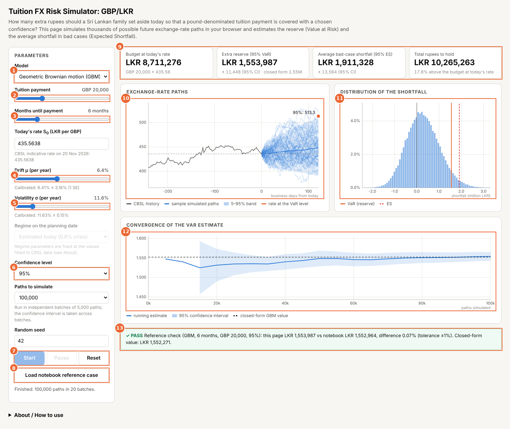
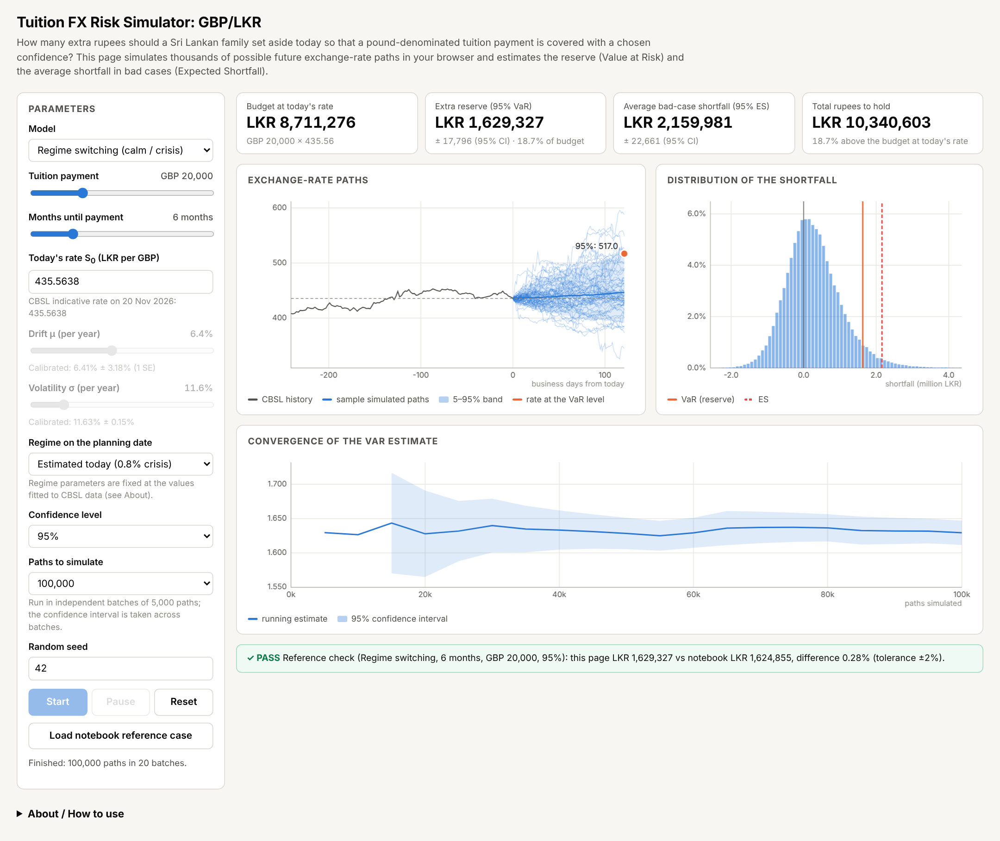

# User guide: web demo

**Open it:** <https://dinethminmu.github.io/fx-tuition-risk/>, or double-click `docs/index.html`. The page is self-contained: it uses no external libraries, needs no internet connection after loading, and runs entirely in your browser. It works in current Chrome, Edge and Firefox.

## Controls

| # | Control | What it does |
|---|---|---|
| 1 | **Model** | Geometric Brownian motion (GBM) or two-state regime switching (calm/crisis) |
| 2 | **Tuition payment** | GBP 5,000–60,000 |
| 3 | **Months until payment** | 1–24 |
| 4 | **Drift μ** | Yearly trend of the rate (GBM only; default 6.4%, the calibrated value) |
| 5 | **Volatility σ** | How much the rate moves (GBM only; default 11.6%) |
| 6 | **Confidence level** | 90%, 95%, 97.5% or 99% |
| — | **Regime on the planning date** | Regime model only: estimated today, calm or crisis |
| — | **Paths / seed** | Number of simulated paths and the random seed |
| 7 | **Start / Pause / Reset** | Runs the simulation in batches of 5,000 paths with live updates; changing any setting resets |
| 8 | **Load notebook reference case** | Sets GBP 20,000, 6 months and 95% to compare with the notebook |

## Outputs

| # | Output | Meaning |
|---|---|---|
| 9 | **Result cards** | Budget at today's rate; **extra reserve** (VaR) with its 95% confidence interval; **average bad-case shortfall** (ES); total rupees to hold. GBM also shows the closed-form VaR. |
| 10 | **Exchange-rate paths** | Recent CBSL history, sample simulated paths, the 5–95% band, and the rate at the VaR level |
| 11 | **Shortfall histogram** | Distribution of the rupee shortfall, with VaR and ES marked |
| 12 | **Convergence** | The running VaR estimate and its confidence interval as more paths are simulated (and the exact value for GBM) |
| 13 | **Reference check** | Compares the page with the notebook: ✓ PASS if within tolerance (GBM 1%, regime 2%) |

## Try this

1. **Reference case.** Press **Load notebook reference case**, then **Start**. The reserve is about LKR 1.55 million and the check shows ✓ PASS (the notebook gives 1,552,964).
2. **Crisis.** Switch the model to regime switching and the starting regime to **Crisis**, then Start. The reserve rises to about LKR 1.87 million.
3. **Tail risk.** Set the confidence level to **99%** and compare the two models. The regime model's heavier tail now matters much more.

## How it works

GBM uses the exact lognormal solution for the reserve and daily steps for the drawn paths. The regime model steps once per CBSL business day (241 per year), switching regime by inverse transform, and uses the parameters fitted to CBSL data in the notebook. Random numbers come from a seeded xoshiro128** generator, with Box–Muller normal variates. See [THEORY.md](THEORY.md).

## Limitations

The demo uses fixed regime parameters and a different random stream from the notebook, so its results differ from the notebook only by Monte Carlo error. It shares the notebook's assumptions: the CBSL indicative rate excludes bank spreads, interest is ignored, and policy shocks cannot be predicted.
